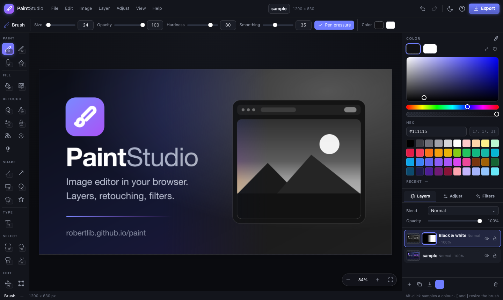

# Paint Studio

A complete image editor and drawing app that runs entirely in the browser — no
build step, no server, no uploads. Open it, drop in a photo, and edit.

**Live:** https://robertlib.github.io/paint/ · editor: https://robertlib.github.io/paint/editor/

The interface is available in English and Czech.



## Features

**Layers** — unlimited layers with 16 blend modes, per-layer opacity,
visibility, locking, drag-to-reorder, rename, duplicate, merge down and flatten.
**Layer masks** (reveal all, hide all or from the selection; paint black to
hide and white to reveal; invert, disable, apply, delete).

**Painting** — brush with hardness/opacity/smoothing and pen-pressure support,
pencil, airbrush, eraser, paint bucket with tolerance and edge expansion, and
linear/radial gradients.

**Retouching** — blur, sharpen, smudge, clone stamp, healing brush, spot
healing (fills the painted area from its surroundings with matched texture) and
dodge/burn by tonal range.

**Shapes & type** — line, arrow, rectangle (with corner radius), ellipse,
polygon and star, each as outline, solid or both. The text tool types directly
on the canvas in the final font; every text becomes a **text layer that stays
editable** until it is painted on.

**Selections** — rectangular, elliptical, freehand lasso and magic wand, with
new/add/subtract/intersect modes, feathering and animated marching ants. Every
brush, fill, filter and adjustment respects the active selection.

**Free transform** — scale, rotate and move a layer or a selection with
handles (proportional corners, Alt from the centre, Shift snaps rotation).

**Photo adjustments** — exposure, brightness, contrast, highlights, shadows,
gamma, saturation, vibrance, temperature, tint, hue, clarity, softness, grain
and vignette, previewing live on the active layer. **Levels** (histogram, per
channel, auto) and **Curves** (per channel).

**Filters** — 21 one-click effects, each shown as a live thumbnail of your own
image.

**Files** — opens PNG, JPEG, WebP, GIF, SVG, BMP, AVIF, **HEIC** (natively in
Safari; elsewhere a decoder is fetched once from jsDelivr, pinned by version and
integrity hash) and **PSD** (8/16-bit RGB or grayscale with layers, masks,
blend modes; groups flattened). Exports PNG, JPEG, WebP with quality, scale and
a live size estimate, and **layered PSD**. `.paint` project files keep layers,
masks and editable text.

**Everything else** — undo/redo history, **autosave** to the browser's own
storage with restore on the next visit, zoom to 3200% with pan and pinch,
dark and light themes, drag-and-drop and clipboard import, offline support and
installable PWA (with "open with" file handling), and a full keyboard shortcut
set (press `?`).

## Running it

It is a static site with no dependencies and no build step:

```sh
python3 -m http.server 8000   # then open http://localhost:8000
```

Any static host works — the project is deployed straight from the repository
root via GitHub Pages.

## Site structure

| Path | What it is |
| --- | --- |
| `/` , `/cs/` | landing pages (English, Czech) with a drop zone that opens the editor |
| `/<task>/`, `/cs/<task>/` | one page per job people search for — crop, resize, PNG to JPG, blur a face… |
| `/editor/` | the editor itself (`noindex`; the landing pages are what search engines rank) |
| `/404.html`, `/sitemap.xml` | generated with the pages |

A landing page hands a dropped file to the editor through IndexedDB (same
origin, nothing is uploaded) and opens `editor/?task=<task>&lang=<lang>&open=1`.
The task (see `js/tasks.js`) selects the right tool and shows a task bar with
the next step — e.g. `?task=crop` brings up the crop frame, `?task=blur` offers
Blur/Pixelate for the selection.

### Regenerating the landing pages

The pages are plain HTML committed to the repository, produced by a
dependency-free Node script from structured copy:

```sh
node scripts/build-site.mjs
```

| File | Contents |
| --- | --- |
| `scripts/site/config.mjs` | base URL, languages, analytics, IndexNow key |
| `scripts/site/pages.mjs` | page ids, slugs per language, task, icon, related pages |
| `scripts/site/content/en.mjs`, `cs.mjs` | all copy (titles, descriptions, steps, sections, FAQ) |

The generator also writes `sitemap.xml` (with `hreflang` alternates), the
IndexNow key file and keeps the `modulepreload` list and analytics snippet of
`editor/index.html` up to date. Adding a language means a new content file, a
dictionary in `js/lang/` and an entry in `config.mjs`.

### Search engines and analytics

- **Analytics** — set `goatcounter` in `scripts/site/config.mjs` to a
  [GoatCounter](https://www.goatcounter.com) site code and rebuild. It is
  cookie-free, so no consent banner is needed. The editor additionally counts
  anonymous events (`event/open-png`, `event/export-jpg`, `event/editor-crop`…);
  no file names or image data are ever sent.
- **IndexNow** (Bing, Seznam, Yandex…) — after a deploy run
  `node scripts/indexnow.mjs` (`--dry-run` to preview).
- **Webmaster tools** — the sitemap is `https://robertlib.github.io/paint/sitemap.xml`;
  submit it in Google Search Console, Bing Webmaster Tools and Seznam Webmaster.

### Moving to a custom domain

1. Point the domain at GitHub Pages and add a `CNAME` file with the domain.
2. Change `base` in `scripts/site/config.mjs` and run `node scripts/build-site.mjs`.
3. Update the `Sitemap:` line in `robots.txt`.

GitHub Pages redirects the old `github.io` address to the custom domain.

## Architecture

ES modules, no framework, no bundler.

| File | Responsibility |
| --- | --- |
| `js/i18n.js`, `js/lang/cs.js` | UI language detection and the Czech dictionary |
| `js/state.js` | app state and a small event bus; preferences persistence |
| `js/doc.js` | document model: layers, masks, text layers, selections, compositing, geometry |
| `js/history.js` | undo/redo commands with a memory budget |
| `js/viewport.js` | zoom/pan and document ↔ screen coordinates |
| `js/render.js` | draws the document, checkerboard and canvas overlays |
| `js/tools.js` | every tool plus pointer, wheel and pinch input |
| `js/filters.js` | adjustment pipeline, effects, levels/curves lookup tables |
| `js/tone.js` | Levels and Curves dialogs |
| `js/actions.js` | application commands used by the UI and shortcuts |
| `js/ui.js` | panels, options bar, colour picker, layers, toasts |
| `js/menus.js` | menu bar, dialogs, shortcuts, drag-and-drop |
| `js/tasks.js` | `?task=` handling and the task bar |
| `js/autosave.js`, `js/store.js` | IndexedDB autosave and the landing-page hand-over |
| `js/psd.js` | PSD reader and writer |
| `js/heic.js` | on-demand HEIC decoder |
| `js/site.js` | landing-page script (drop zone → editor) |

Strokes are painted into a document-sized floating buffer that is composited
above the active layer and flattened on pointer-up, so semi-transparent brushes
never darken where they overlap and every stroke is a single undo step.
Compositing caches everything below the active layer, which keeps painting fast
on tall layer stacks. A layer mask is a second canvas whose alpha is the
visibility; while a mask is the paint target, strokes are translated from
colour to mask value and the preview only recomputes the area the brush
touched.

Images never leave the device — all editing happens on the local canvas.

## Licence

MIT — see [LICENSE](LICENSE).
